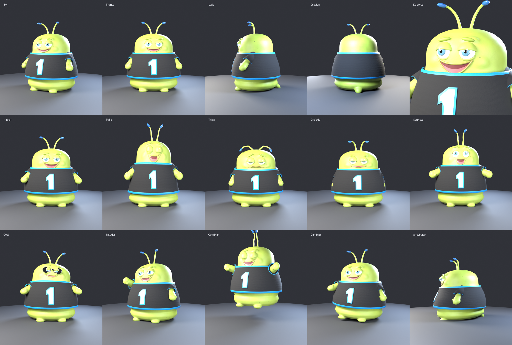

# Cody, la mascota de la app de fantasy 🐛🏈

Gusano gordito con camiseta, hecho en Blender 5.2 a partir de la hoja de diseño.



## Archivos

| Archivo | Para qué |
| --- | --- |
| `mascota.blend` | Abrir y editar en Blender |
| `mascota.glb` | Modelo para la app (Three.js): malla, esqueleto y animaciones |
| `visor.html` | Visor para probar animaciones y camisetas (abrir con un servidor local) |
| `crear_mascota.py` | Script que construye todo desde cero |
| `renderizar.py` | Saca las imágenes de la hoja |

## Animaciones

`Reposo`, `Hablar`, `Feliz`, `Triste`, `Enojado`, `Sorpresa`, `PonerLentes` (se baja los lentes
de la frente), `Cool` (con lentes wayfarer y finger guns), `Arrastrarse`, `Celebrar`, `Caminar`, `Saludar`
y con **balón de fútbol americano**: `Malabares`, `Lanzar` (pase en espiral) y `Touchdown` (salta y lo clava).

## Camisetas de equipos

Un solo modelo. La app cambia el color de estos materiales:
`Camiseta`, `Camiseta_Ribete`, `Numero`, `Numero_Borde`. Sin logos ni marcas.

## Volver a generarla

```bash
pip install bpy==5.2.3          # o usar el Blender instalado
python mascota/crear_mascota.py -- mascota
python mascota/renderizar.py -- mascota/mascota.blend mascota/render 32
```

Para ver el visor: `npx serve mascota` y abrir `/visor.html`.
